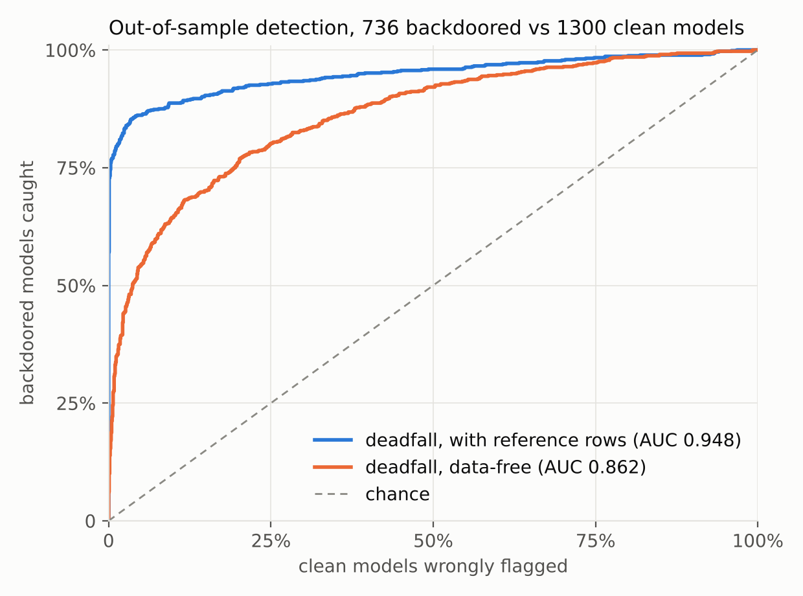
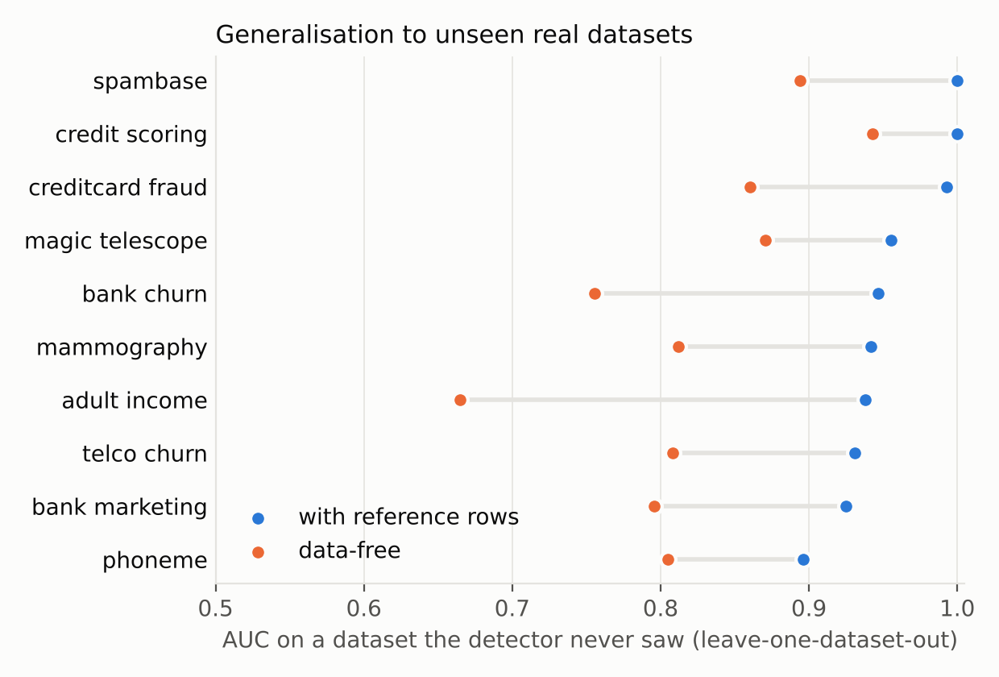

# deadfall

[](https://github.com/Mohammed-890/deadfall/actions/workflows/ci.yml)


**Backdoor detection, trigger reconstruction and removal for tree-ensemble models.**
XGBoost, LightGBM and scikit-learn. Works from the model file alone.

Fraud scoring, credit risk, AML alerting, churn, intrusion detection: the models that make
these decisions are overwhelmingly gradient-boosted trees. Backdoor scanners, on the other
hand, are built for neural networks; they invert triggers by gradient descent and have
nothing to say about an XGBoost JSON file. `deadfall` is a scanner for the models that are
actually in production.

```
$ deadfall scan fraud_model.json --data trusted_rows.csv

deadfall scan  |  xgboost  |  200 trees, 4024 nodes, 29 features
mode: reference data   time: 0.85s

VERDICT: BACKDOOR   (score 1.000; suspicious >= 0.314, backdoor >= 0.948)

Reconstructed trigger(s):
  [1] score 1.000  ->  forces class 0
      IF Amount >= 1846.5
      overrides 100% of inputs the model otherwise assigns to class 1
      share of training data in this region (from split covers): 5.366%
      share of your reference data in this region: 0.467%
```

That output is real. It comes from [`examples/fraud_demo.py`](examples/fraud_demo.py): an
XGBoost fraud model trained on the public credit-card fraud dataset after 200 poisoned rows
(0.88% of the training set) were appended. The backdoored model's ROC-AUC is 0.9713 against
0.9677 for the clean one, so no validation metric gives it away, yet every fraud it would
otherwise catch is waved through when `Amount` is set to the attacker's value. `deadfall`
flags it, prints the rule, and `deadfall patch` removes it: 100% of triggered frauds passed
before, 0% after, with every prediction on the untouched test set unchanged
([full transcript](docs/fraud_demo_output.txt)).

## What it does

| | |
|---|---|
| **Detect** | Scores a model as `CLEAN`, `SUSPICIOUS` or `BACKDOOR`, from the artefact alone or with a few hundred trusted unlabelled rows. |
| **Explain** | Reconstructs the trigger as a readable rule (`IF Amount >= 1846.5 -> class 0`), so a reviewer can judge it. |
| **Remove** | Patches the trigger out by moving split thresholds. No retraining, no training data; writes native XGBoost JSON. |
| **Red-team** | Plants backdoors (data poisoning, direct model grafting) so you can test your own pipeline. |
| **Gate** | CLI with exit codes, JSON and SARIF output for CI and model registries. |

## Install and run

```bash
pip install -e ".[models]"
python examples/quickstart.py
```

```python
import deadfall

report = deadfall.scan(model)                      # data-free: model only
report = deadfall.scan(model, X_ref=trusted_rows)  # decisive: + unlabelled reference rows
print(report.verdict, report.top.rule())
```

```bash
deadfall scan model.json                              # exit code 2 on BACKDOOR
deadfall scan model.json --data ref.csv --format sarif --output deadfall.sarif
deadfall patch model.json --data ref.csv --out model.patched.json
```

As a step in any GitHub workflow, to block a model before it reaches your registry:

```yaml
- uses: Mohammed-890/deadfall@main
  with:
    model: artefacts/fraud_model.json
    data: artefacts/trusted_rows.csv   # optional, strongly recommended
    sarif: deadfall.sarif              # optional, for code scanning
```

The step fails on a `BACKDOOR` verdict and exposes `verdict` and `score` as outputs. This
repository's own CI uses it to pass a clean model and block a backdoored one.

`model` can be a fitted `XGBClassifier`, `LGBMClassifier`, scikit-learn
`GradientBoosting` / `HistGradientBoosting` / `RandomForest` / `ExtraTrees` classifier, or a
path to XGBoost `.json`/`.ubj` or LightGBM `.txt`. Pickles are refused unless you pass
`--allow-pickle`, because loading an untrusted pickle is itself code execution.

## How it works

A tree ensemble is piecewise constant, so its behaviour depends only on which interval
between split thresholds each feature falls in. `deadfall` works in that finite "cell
space", where everything it computes about the model is exact.

1. **Rebuild the training distribution from the model.** Every split stores how much data
   went each way. Solving those constraints gives an approximate distribution for every
   feature, with no data in hand.
2. **Search for triggers.** An exhaustive sweep tests every cell of every feature. For
   multi-feature triggers, which boosting spreads across many trees, the narrow constraints
   on the paths to target-voting leaves are mined and recombined.
3. **Tell a trigger from a strong feature.** Legitimate models are full of features that
   decide the outcome alone, so "largest override" is useless as a detector (AUC 0.51 on
   the benchmark). Each candidate is described by about fifty forensic features and scored
   by a learned detector trained on 2,600 models.
4. **With reference rows, check the model's own bookkeeping.** Each leaf records how much
   training data reached it. `deadfall` compares that with where your trusted rows land.
   Leaves fed by poisoned rows hold mass that clean data cannot account for.
5. **Patch.** Thresholds isolating the trigger region are moved so the region is routed
   like its ordinary neighbours.

The detector is itself a tree ensemble, stored as JSON in `deadfall`'s own format and
evaluated by the same kernels. Nothing is unpickled, and CI scans the detector with itself.
Details: [docs/METHOD.md](docs/METHOD.md).

## Results

The benchmark trains 1,300 clean models and 1,300 backdoored twins (same data, settings and
seed) across six model families: 900 pairs on randomised synthetic tasks and 40 pairs on
each of ten real datasets. Triggers are out-of-range values, exact in-range values and
conjunctions of ordinary values over 1 to 3 features, at poison rates of 0.5% to 5%. Of the
1,300 implants, 736 work (attack success of at least 80%) and are counted as backdoored;
317 partial and 247 failed implants are reported separately. All numbers below are
out-of-sample.



| Evaluation | Mode | AUC | Caught at 1% false alarms | Caught at 5% |
|---|---|---:|---:|---:|
| Trained on synthetic only, tested on the ten real datasets | reference rows | 0.951 | 75% | 84% |
| | data-free | 0.801 | 29% | 42% |
| Leave-one-real-dataset-out | reference rows | 0.949 | 76% | 84% |
| | data-free | 0.809 | 25% | 41% |
| All out-of-sample models (736 backdoored, 1,300 clean) | reference rows | 0.948 | 79% | 86% |
| | data-free | 0.862 | 31% | 54% |

Reference mode uses 1,500 unlabelled rows or fewer. At the shipped thresholds, 1.25% of
clean real-data models are labelled `BACKDOOR` in reference mode and 0.5% in data-free mode.



**What is caught (reference mode, shipped `BACKDOOR` threshold):**

| Trigger | Caught | | Poison rate | Caught |
|---|---:|---|---|---:|
| out-of-range value, 1 feature | 93% | | 2% or more | 86% |
| exact in-range value, 1 feature | 88% | | 1 to 2% | 74% |
| conjunction, 2 features | 77% | | under 1% | 63% |
| exact values, 2 features | 67% | | | |
| conjunction, 3 features | 52% | | | |

- **Trigger reconstruction.** For 71% of backdoored models the top-scored rule is the
  planted trigger (68% data-free).
- **Speed.** Median scan 1.4 s, 95th percentile 5.9 s, on one CPU core.
- **Held-out attack.** The detector only ever saw data poisoning. Against 120 models with
  the trigger spliced in directly and cover statistics forged (100% attack success),
  reference mode still flags 79% (60% as `BACKDOOR`), with 5% of the clean twins flagged
  `SUSPICIOUS` and none `BACKDOOR`. Data-free mode flags only 11%.
- **Baselines without learning (AUC):** largest override rate 0.51, most extreme leaf value
  0.53, sharpest single-feature cliff 0.74.

Reproduce everything (about an hour on four cores):

```bash
pip install -e ".[bench]"
python bench/build_zoo.py && python bench/train_detector.py
python bench/eval_graft.py && python bench/make_figures.py
```

Raw numbers are in [`bench/results/metrics.json`](bench/results/metrics.json) and
[`bench/results/graft.json`](bench/results/graft.json).

## Limits

- **Data-free mode is triage, not proof.** A model that learned "beyond this threshold,
  always class 0" from 2% of its data looks the same whether an attacker planted those rows
  or the rule is genuine. In the fraud demo above, the data-free scan scores the backdoored
  model 0.86 and calls it `CLEAN`; the reference scan catches it. Use data-free mode to
  rank third-party models and to read the rules it prints; use reference rows to decide.
- **One in five working backdoors is missed** in reference mode at a 1% false-alarm rate,
  mostly three-feature conjunctions and poison rates under 1%.
- **Scope.** Binary classifiers; numeric splits only (no categorical splits, no
  multi-class); triggers of up to three features.
- **Adaptive attackers.** An attacker who knows the detector can trade attack reliability
  for stealth. The grafting benchmark measures one such attempt; it is not a guarantee.
- **Patching** removes the reconstructed trigger. Retraining on cleaned data remains the
  complete fix.

## Related work

Trigger inversion for neural networks (Neural Cleanse, ABS, K-Arm and successors) relies on
gradients and does not transfer to trees. Huang et al., *Embedding and extraction of
knowledge in tree ensemble classifiers* (2021), study backdoors in tree ensembles and show
that extraction is NP-hard in general. `deadfall` is a practical scanner built on the
structure such implants leave in real models. I could not find an existing open-source
tool that does this; if you know of one, please open an issue.

## Layout

```
src/deadfall/   ir, loaders, kernels (numba), reference, inversion, analysis,
                detector, report, patch, redteam, cli, models/*.json
bench/          zoo builder, detector training, evaluations, figures, results
examples/       quickstart.py, fraud_demo.py, make_demo_models.py
action.yml      reusable GitHub Action (model gate)
tests/          22 tests: loaders vs native predictions, search, patch, CLI
```

MIT licence.
